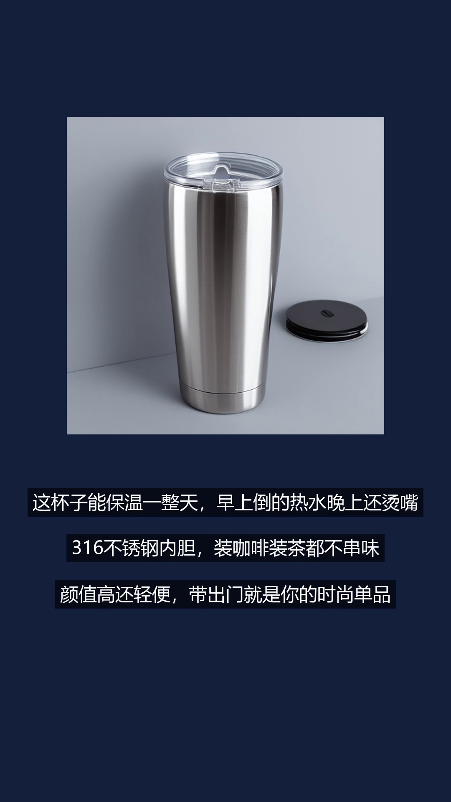

# AIGC 视频工作流（电商内容自动生成）

输入一个商品名，自动产出一条**竖屏带货短视频**：文案 + 商品图 + 配音 + 字幕，全流程零人工。

## Demo



（完整视频见 [demo.mp4](demo.mp4)）

## 工作流

```
商品名（中文）
  → ① 文案生成（DeepSeek）      → 口播稿
  → ② 提示词翻译（DeepSeek）    → 英文图片 prompt
  → ③ 商品图生成（ComfyUI+SD1.5）→ 产品图（本地 GPU）
  → ④ 配音合成（edge-tts）      → 口播音频
  → ⑤ 视频合成（ffmpeg）        → 竖屏 mp4（商品图 + 字幕 + 配音）
```

## 技术栈

| 环节 | 技术 |
|---|---|
| 文案 / 翻译 | DeepSeek API |
| 图片生成 | ComfyUI + Stable Diffusion 1.5（本地，RTX 3060 6GB） |
| 配音 | edge-tts（免费微软 TTS） |
| 视频合成 | ffmpeg |
| 容器化 | Docker / docker-compose |

## 快速开始

```bash
# 1. 装依赖
pip install -r requirements.txt

# 2. 准备字体（微软雅黑，Windows 自带）
cp C:/Windows/Fonts/msyh.ttc .

# 3. 启动 ComfyUI（需先装好 ComfyUI 并放入 SD 模型到 models/checkpoints/）
#    ComfyUI 默认监听 http://127.0.0.1:8188

# 4. 设置 API key
export DEEPSEEK_API_KEY=sk-xxx

# 5. 运行（传入商品名）
python video_workflow.py "一款保温杯"
```

## 容器化

```bash
docker compose build
docker compose run --rm video-workflow "一款保温杯"
```

容器内通过 `host.docker.internal:8188` 访问宿主机的 ComfyUI。

## 关键设计

1. **每个环节是独立函数**，可替换——换图片模型（如 SDXL/Flux）只改 `generate_image` 一个函数。
2. **SD 模型中文 prompt 理解差**：直接喂"保温杯"会生成冰饮，必须先翻译成英文 prompt。
3. **API key 不写进镜像**，运行时通过环境变量传入。
